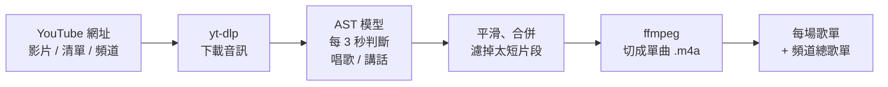

# vsong 🎤

**從長時間的直播、錄影或錄音中，自動擷取唱歌的段落，只聽歌、跳過聊天。**

給它 YouTube 網址（單一影片、播放清單或頻道），或電腦裡的影片、音檔，vsong 會用 AI 判斷哪些段落在唱歌，把每首歌切成獨立的音樂檔，依頻道分資料夾整理好，電腦和手機都能直接播放。適合歌唱直播、卡拉 OK 錄影、演唱會、現場演出等「歌和說話混在一起」的長內容。

```
python vsong.py "https://www.youtube.com/watch?v=XXXX"
```

```
out/頻道名稱/
├── all_songs.m3u8          ← 這個頻道所有的歌
├── versions/ビビデバ.m3u8   ← 同一首歌在不同場的版本
├── library.csv             ← 歌庫總表
└── <影片ID>/songs/
    ├── 01 0h12m34s.m4a
    ├── 02 Stellar Stellar.m4a
    └── playlist.m3u8
```

## 功能

- 🎵 **自動偵測歌曲**：AI 音訊分類模型加上音量，每 3 秒判斷一次「唱歌」或「講話」，連邊放 BGM 邊聊天的段落也能排除，間奏也不會被切斷
- ✂️ **切成單曲**：每首歌一個 `.m4a`，照原音切、不加淡入淡出，標籤自動帶入歌名、頻道、直播標題
- 💾 **電腦裡的檔案**：自己錄的影片或音檔（mp4、mkv、m4a、mp3、wav…）也能處理，給資料夾會處理裡面所有影音檔
- 📋 **播放清單與頻道**：一次處理整個清單或頻道，可依標題關鍵字篩選，處理過的會自動跳過
- 👤 **依頻道分資料夾**：以頻道 ID 辨識，頻道改名也不會分成兩個資料夾
- 🔁 **重複歌曲全部保留**：同一首歌在不同場的演唱都保留，另外整理成各版本清單
- 🔎 **辨識歌名（選用）**：先找 YouTube 留言裡的粉絲歌單，找不到再用 Gemini 聽歌詞＋Google 搜尋，翻唱也認得出來
- 📱 **手機可用**：輸出標準音樂檔和相對路徑的播放清單，同步到手機就能聽

## 運作原理



判斷使用 [AST（Audio Spectrogram Transformer）](https://huggingface.co/MIT/ast-finetuned-audioset-10-10-0.4593)，一個在 AudioSet 上訓練的音訊分類模型。每個 6 秒的視窗會得到三個分數：

| 分數 | 來源標籤 |
|---|---|
| `sing` | Singing、Vocal music、Song 等 |
| `music` | Music |
| `speech` | Speech、Conversation 等 |

綜合分數是 `music + sing − speech`，再加上**音量**：

- 邊放 BGM 邊聊天時，`speech` 分數高會把總分拉下來，所以不會被誤判成歌
- AST 對「卡拉 OK 伴奏＋人聲」常常認不出 `sing`，但唱歌時通常比聊天大聲很多。vsong 會自動找出這一場「聊天」和「唱歌」的音量分界（不同場、不同音量設定都能適用），比分界大聲就加分、小聲就扣分。不過持續講話超過約 45 秒時（大聲聊天、邊放 BGM 邊講），音量只扣分不加分，免得講話被當成歌

總分超過門檻（預設 0.5）就視為在唱歌。之後：

1. 中位數平滑，合併 8 秒內的空隙
2. **間奏不切斷**：兩段之間 30 秒內沒人講話、合起來不超過 6.5 分鐘、其中一段短於 2.5 分鐘，就當成同一首（間奏、安靜的段落會掉分）；不講話直接接下一首的兩首完整的歌不會被合併
3. 丟掉短於 60 秒的片段
4. **頭尾不切掉**：邊界往外延伸到有人講話為止（最多 15 秒），再前後各多留 2 秒
5. **好幾首連著唱**：超過 6.5 分鐘的段落，在音量突然掉下去的地方（歌和歌之間的空檔）切開
6. **結尾不帶聊天**：唱完接著一直講話的部分切掉

用 4 場有觀眾整理歌單的歌唱直播（共 57 首）驗證：57 首全部抓到、沒有多抓，開頭誤差中位數 2～4 秒。

## 需求

- Python 3.11 以上（Gemini 辨識歌名用的 google-genai 2.34 需要 3.11）
- [ffmpeg](https://ffmpeg.org/)
- [Deno](https://deno.com/)（yt-dlp 用來解 YouTube 的 JS 驗證，沒有的話常常抓不到音訊）
- 建議有 NVIDIA 顯卡（沒有也能跑，只是慢很多）

## 安裝

### Windows 11

```powershell
# 1. 安裝 ffmpeg（裝完重開終端機）
winget install Gyan.FFmpeg
winget install DenoLand.Deno

# 2. 下載專案
git clone https://github.com/<你的帳號>/vsong.git
cd vsong

# 3. 建立虛擬環境（建議）
python -m venv .venv
.venv\Scripts\activate

# 4. 先裝 CUDA 版 PyTorch（指令依 https://pytorch.org 選擇你的 CUDA 版本）
pip install torch torchaudio --index-url https://download.pytorch.org/whl/cu124

# 5. 安裝其餘套件
pip install -r requirements.txt
```

> ⚠ 第 4 步一定要在第 5 步之前，不然 pip 會裝成只能用 CPU 的 PyTorch。
> 確認是否有用到顯卡：`python -c "import torch; print(torch.cuda.is_available())"` 應該印出 `True`。

### macOS / Linux

```bash
# macOS：brew install ffmpeg　　Ubuntu：sudo apt install ffmpeg
git clone https://github.com/<你的帳號>/vsong.git
cd vsong
python3 -m venv .venv && source .venv/bin/activate
pip install -r requirements.txt
```

### 安裝成指令（選用）

```bash
pip install -e .              # 之後可以直接打 vsong 取代 python vsong.py
pip install -e ".[identify]"  # 加上歌名辨識
```

## 快速開始

```bash
# 處理一場歌唱直播
python vsong.py "https://www.youtube.com/watch?v=XXXX"

# 順便辨識歌名
python vsong.py "https://www.youtube.com/watch?v=XXXX" --identify

# 處理某個頻道最近 20 場標題含「歌枠」或「karaoke」的直播
python vsong.py "https://www.youtube.com/@頻道名/streams" --filter 歌枠,karaoke,歌ってみた --limit 20

# 電腦裡的影片或音檔，放進「我的頻道」資料夾（不指定 --channel 會放進「本機檔案」）
python vsong.py "D:/錄影/karaoke.mp4" --channel "我的頻道"

# 整個資料夾（含子資料夾），只處理檔名含「歌枠」的
python vsong.py "D:/錄影/某頻道" --channel "我的頻道" --filter 歌枠
```

第一次執行會下載 AST 模型（約 300 MB）。一場兩小時的直播，用 RTX 40 系列顯卡分析大約幾分鐘。

## 網頁介面

不想打指令的話，可以開本機網頁介面。Windows 直接雙擊 **`Start.bat`**（會自動用 `.venv` 裡的 Python），或：

```bash
python webui.py               # 自動開啟 http://127.0.0.1:8765
vsong-web --port 9000         # 用 pip install -e . 安裝後也可以這樣開
```

四個頁面，照實際流程排：

1. **新增**：貼上網址，或用「選擇檔案…」「選擇資料夾…」挑電腦裡的影片，按開始處理。會自動切歌、找粉絲歌單、辨識歌名、檢查切點。進度在右上角，點開是工作面板（紀錄、停止、排隊中的工作）
2. **修切點**：左邊是場次清單（待修／已完成／全部，可疑切點多的排前面），右邊是這場的工作區：
   - **整場縮圖**：分數曲線和每首的位置，可疑的標琥珀色；點色塊跳到那首，點空白處從那裡播
   - **時間軸**：開始、結束旁邊就是 ⏱ 填入播放位置、聽頭、聽尾、聽後；合併、切開、刪除；時間精確到 0.01 秒
   - **看圖**：右邊顯示目前這首開頭、結尾前後的頻譜和音量。點一下試聽（結尾從那裡播到結束時間），雙擊或右鍵設成切點；黃色 ▼ 是候選切點（附近的安靜），`,` `.` 換候選、`Enter` 設定
   - **可疑切點**：程式沒把握的切點標 ⚠，聽過沒問題按「✓ 沒問題」；舊的歌庫按「檢查切點」補標
   - **儲存並修下一場**（`Ctrl`+`Enter`）：儲存、重新切檔（排隊進行，不用等）、標為已手動處理，然後直接打開下一場
   - **粉絲歌單**分頁：對照採用的歌單、手動貼上歌單照它切；「⋯」選單裡有重新偵測（調整門檻）、刪除這場
3. **歌庫**：依頻道瀏覽、搜尋、播放整場／整個頻道／隨機，下載歌庫表。每場預設收合，標示已手動處理、可疑切點數、歌單來源。🗑 刪除整場（原始音訊、切好的歌、時間軸），可以勾選記住，之後處理清單、頻道時不會再下載回來（記在 `out/deleted.json`；直接貼那部的網址就會重新處理）

4. **匯出**：勾選頻道、場次或單首歌（可篩選「只要有歌名的」「同一首只要最新一版」），匯出到指定資料夾，給手機、隨身碟或其他播放器、音樂庫用：
   - **格式**：`m4a`（預設，原樣複製、不重新編碼，音質不變）或 `mp3`
   - **音量正規化**（選用）：每首調到 -16 LUFS（兩遍 loudnorm，線性調整不壓縮動態），跟其他歌混著聽不會忽大忽小；會重新編碼
   - **檔名**是「歌名(YYMMDD) - 頻道名稱」，例如 `アイドル(250314) - Aちゃん Ch.m4a`，同一首歌不同場、不同人唱都分得出來；同名的加 ` #2`。可選每個頻道一個資料夾，或全部放同一個資料夾
   - 標籤會寫好歌名、Vtuber（`artist`／`album_artist`）、直播標題（`album`）、直播日期、原唱（註解）、YouTube 時間戳連結；m4a 有 faststart，網頁串流可以馬上開始播
   - 目的資料夾已有同名檔案的略過（可勾選覆蓋），重複匯出只會補上新的歌

播放器的 **⚖ 音量平衡**（預設開）：每首歌量整首的響度（EBU R128，結果存在各場的 `loudness.json`），播放時調到差不多大聲，旁邊顯示這首調了幾 dB；調大聲時有限制器，不會爆音。只影響網頁上播放，不會改音檔。

按 `?` 看所有快捷鍵。**已手動處理**的場次（存檔時自動勾上）之後處理影片都會略過，時間軸不會被重新偵測蓋掉。

只對本機（127.0.0.1）開放，不需要額外套件。處理影片一次一個；重新切檔、檢查切點等會排隊接著做。

## 用法

```
python vsong.py [網址 ...] [選項]
```

網址可以是單一影片、播放清單或頻道，也可以是電腦裡的影片、音檔或資料夾，一次給好幾個也可以。

| 選項 | 說明 | 預設 |
|---|---|---|
| `--identify` | 辨識歌名（YouTube 先找粉絲歌單；`.env` 有 `GEMINI_API_KEY` 用 Gemini，否則用 Shazam） | 關 |
| `--identify-with` | 指定 `gemini` 或 `shazam` | `auto` |
| `--gemini-model` | Gemini 模型 | `gemini-3.1-flash-lite` |
| `--reidentify` | 之前自動辨識的歌名全部重來（手動填的、粉絲歌單的保留） | 關 |
| `--merge` | 另外輸出整場歌曲串在一起的 `songs_only.m4a` | 關 |
| `--threshold N` | 判斷為歌曲的分數門檻，越高越嚴格 | `0.5` |
| `--min-len 秒` | 短於這個長度的片段會被丟掉 | `60` |
| `--max-gap 秒` | 小於這個長度的空隙會被合併 | `8` |
| `--pad 秒` | 每首歌前後各多留幾秒 | `2` |
| `--extend 秒` | 前奏／尾奏邊講話時，邊界最多往外延伸幾秒（0 表示不延伸） | `15` |
| `--filter 關鍵字` | 清單/頻道/資料夾只處理標題（檔名）含這些字的影片，逗號分隔 | 全部 |
| `--limit N` | 每個清單/頻道/資料夾最多處理幾部 | 全部 |
| `--channel 名稱` | 電腦裡的檔案要放進哪個頻道資料夾 | `本機檔案` |
| `--force` | 清單中已處理過的影片也重新處理 | 關 |
| `--sleep 秒` | 每次連 YouTube 至少隔幾秒，避免被當成機器人；已下載好的影片不用連線也不用等（`0` 表示不停） | `5-10` |
| `--jobs N` | 清單、資料夾同時處理幾部（AI 分析一次一部，連 YouTube 照樣排隊） | `2` |
| `--no-lengths` | 不要用 iTunes 查原曲長度 | 關 |
| `--recut 影片ID` | 依手動修改後的 `timeline.json` 重新切檔 | |
| `--library` | 只重建各頻道的總歌單 | |
| `--export 設定.json` | 依設定檔匯出挑選的歌（網頁「匯出」頁會自動產生，一般不用自己寫） | |
| `--reanalyze` | 忽略快取，重新跑 AI 模型 | 關 |
| `--cookies 檔案` | 會員限定影片，使用從瀏覽器匯出的 `cookies.txt`（建議） | |
| `--cookies-from-browser 瀏覽器` | 會員限定影片，直接讀 `firefox`、`chrome` 或 `edge` 的登入狀態 | |
| `--out 資料夾` | 輸出位置 | `out` |
| `--batch N` | GPU 批次大小，顯示卡記憶體不足時調小 | `16` |

## 辨識歌名（翻唱）

`--identify` 依序用這幾種方式找歌名：

1. **Holodex**（選用，適用 VTuber 的 YouTube 直播）：[Holodex](https://holodex.net) 上社群整理的歌曲標記（有開始和結束時間，直接照著切），沒有的話找 Holodex 收集的時間戳留言。不用連 YouTube，會員限定影片也不用 cookies。要在 `.env` 加上 `HOLODEX_API_KEY`（holodex.net 登入後，右上角帳號 → Account Settings）
1. **粉絲歌單**（YouTube 影片）：從說明欄和熱門留言裡找粉絲整理的歌單（「4:38 歌名 / 原唱」這類），對到時間就直接用。免費、最準
2. **Gemini**（設定金鑰後）：每首歌取一段 40 秒，請 Gemini **聽寫歌詞**，再用歌詞 **Google 搜尋**，並確認原曲歌詞裡真的有那幾句。第一段找不到就換歌曲另一段再試一次
3. **Shazam**（沒有 Gemini 金鑰時）：只認得原曲錄音，翻唱幾乎認不出來

**有粉絲歌單時，切歌也以歌單為準**：每首從歌單的時間開始切；歌單有寫結束時間（`0:04:37～0:07:34`）就照用，沒寫就切到偵測到的歌結束（不超過下一首）。歌單有、但沒偵測到的歌也會照歌單切出來；歌單範圍內、歌單沒寫的段落大多不是歌（BGM、試唱），會丟掉；歌單只寫了前半場時，後半場偵測到的歌會保留並用 Gemini 辨識。採用的歌單會存在 `timeline.json`，網頁上可以按「粉絲歌單」對照。

**同一首歌被切成好幾段**（間奏、喊聲）：辨識完如果相鄰兩段是同一首、中間隔不到 60 秒，會自動合成一首；隔比較久又唱一次（安可）則兩次都保留。

**原曲長度**：短於 3 分鐘的歌會用 iTunes 查原曲長度（免費、不用金鑰，結果存在 `out/song_lengths.json`）。比原曲短很多時，網頁上會標「比原曲短」提醒你聽聽看——可能唱一半被切掉，也可能本來就是 TV size 或只唱第一段，所以只提醒、不自動延長。依粉絲歌單切、又沒偵測到某首時，也會用原曲長度當預設長度。

Gemini 憑記憶直接猜的歌名幾乎都是錯的，而且很有自信（實測 12 首只對 1 首），所以一定會用歌詞搜尋確認（實測 12 首對 11 首、0 首錯）。都找不到的歌，會把聽到的歌詞記在 `timeline.json`，網頁上有「🔍 用歌詞搜尋」按鈕，點一下就能自己查。

**設定金鑰**（到 [Google AI Studio](https://aistudio.google.com/apikey) 申請）：

把專案裡的 `.env.example` 複製成 `.env`，填入金鑰：

```
GEMINI_API_KEY=你的金鑰
```

`.env` 不會被加進 git。改了金鑰不用重開網頁介面，下一次處理就會用新的。`.env` 優先於系統環境變數。

**費用**：預設用 `gemini-3.1-flash-lite`，每首約 0.002 美元（一場 12 首約 0.03 美元）。想換模型用 `--gemini-model`。Google 搜尋平均每首 5～7 次；每月前 5,000 次免費（大約 700～1,000 首），每場最後會顯示用了幾次。粉絲歌單對到的歌不用花任何費用。Google 搜尋要付費方案才能用；免費方案只會記下聽到的歌詞。

**重跑不會重複花錢**：改門檻重跑時，時間差不多的歌會沿用之前的歌名，只辨識新出現的歌。之前的結果不對時，加 `--reidentify`（網頁上勾「重新辨識」）：自動辨識的歌名全部重來，手動填的和粉絲歌單的會保留。

## 輸出結構

```
out/
├── channels.json                   頻道 ID ↔ 資料夾名稱對照
└── <頻道名稱>/
    ├── all_songs.m3u8              這位的所有歌，依直播日期排序
    ├── library.csv                 歌庫總表（Excel 可開，含跳到該首歌的 YouTube 連結）
    ├── versions/<歌名>.m3u8        同一首歌在不同場的所有版本
    └── <影片ID>/
        ├── songs/
        │   ├── 01 0h12m34s.m4a     沒有歌名時用開始時間命名
        │   ├── 02 ビビデバ.m4a      有歌名時用歌名
        │   └── playlist.m3u8       這一場的播放清單
        ├── songs_only.m4a          （--merge）整場歌曲合輯
        ├── timeline.json           時間軸，可手動編輯
        ├── scores.csv              每 3 秒的分數，調整門檻用
        ├── scores.npy              分析結果快取
        ├── loudness.npy            音量快取
        └── source.*                原始音訊（重新切檔時用）
```

**檔名規則**：`曲序 歌名.m4a`，沒有歌名時用 `曲序 開始時間.m4a`。Windows 不允許的字元會換成 `_`。

**音檔格式**：AAC 192 kbps（`.m4a`），iPhone、Android、Windows、macOS 都能直接播放，並支援歌名、演出者、專輯等標籤。專輯欄位是直播標題，所以音樂 App 會把每場直播歸成一張專輯。

**頻道歸屬**：以開台的人為準，聯動直播會放在開台那位的資料夾。

## 調整準確度

偵測不準時，有三種修正方式：

**1. 調整門檻**（最快，分析結果有快取，幾秒就重算完）

```bash
python vsong.py 網址 --threshold 0.6   # 把聊天誤判成歌 → 調高
python vsong.py 網址 --threshold 0.3   # 漏掉歌曲 → 調低
```

打開 `scores.csv` 可以看每 3 秒的分數，找出適合這個頻道的門檻。

**2. 手動編輯時間軸**

編輯 `out/<頻道>/<影片ID>/timeline.json`，修改 `start`、`end`（秒）或填入 `title`，然後：

```bash
python vsong.py --recut 影片ID
```

**3. 頭尾被切掉**

```bash
python vsong.py 網址 --pad 4          # 前後各多留 4 秒
python vsong.py 網址 --extend 25      # 前奏很長、邊講話邊放前奏時，往外找得更遠
```

改這兩個重跑不用重新分析，之前的歌名也會保留。

**4. 調整合併規則**

兩首歌被合併成一首時，調小 `--max-gap`；一首歌被切成兩段時，調大 `--max-gap`。

## 在手機上聽

vsong 在電腦上處理（需要 GPU），產出的音檔同步到手機播放：

1. 用 Google Drive、OneDrive 或 [Syncthing](https://syncthing.net/) 同步 `out` 資料夾，或只同步某個頻道的資料夾
2. **排除 `source.*`、`scores.*` 和 `loudness.npy`**，原始音訊很大，手機上用不到
3. 用支援 `.m3u8` 的播放器打開 `all_songs.m3u8` 或各場的 `playlist.m3u8`

也可以用網頁的 **匯出** 頁，只把想聽的歌匯出到同步資料夾（m4a 原樣或 mp3、可選音量正規化），手機上就不會有原始音訊這些大檔案。

使用 Syncthing 的話，可以把專案裡的 [`.stignore.example`](.stignore.example) 複製到 `out/` 並改名為 `.stignore`，就會自動排除不需要的檔案。

## 常見問題

**YouTube 下載失敗？**
先更新 yt-dlp：`pip install -U "yt-dlp[default]"`。YouTube 常常改版，舊版 yt-dlp 很快就會失效。出現「Requested format is not available」或「Signature solving failed」時，通常是 YouTube 的 JS 驗證沒有解開：確認裝了 [Deno](https://deno.com/)（`deno --version`），以及 `yt-dlp[default]`（會一起裝 `yt-dlp-ejs`）。

**顯示「沒偵測到 CUDA」，速度很慢？**
裝到 CPU 版的 PyTorch 了。先 `pip uninstall torch torchaudio`，再依[安裝](#安裝)第 4 步重裝 CUDA 版。

**顯示卡記憶體不足（CUDA out of memory）？**
加上 `--batch 4` 或 `--batch 8`。

**歌名辨識不出來？**
沒設定 Gemini 金鑰時用的是 Shazam，它比對原曲錄音，翻唱幾乎認不出來，請參考[辨識歌名（翻唱）](#辨識歌名翻唱)設定 Gemini。Gemini 也辨識不出來的，網頁介面上可以用聽到的歌詞一鍵搜尋，再手動填入歌名。

**兩首歌連在一起變成一首？**
兩首歌之間幾乎沒有聊天時會發生。手動編輯 `timeline.json` 拆開，或調小 `--max-gap`。

**電腦裡的檔案是怎麼處理的？**
vsong 會把影片的音軌取出來存成 `source.*`（AAC、MP3、Opus 等直接複製、不重新編碼），原始檔案不會被修改或移動。資料夾名稱是 `file-` 加上一串由檔名和大小算出的代碼，同一個檔案再處理一次會用快取。日期使用檔案的修改日期，標題用檔名。

**會員限定影片怎麼處理？**
需要你的 YouTube 登入狀態。建議用 `cookies.txt`：

1. 在瀏覽器裝一個能匯出 cookies.txt（Netscape 格式）的擴充功能，登入 YouTube 後在 youtube.com 匯出
2. 網頁介面「會員限定影片」選「cookies.txt 檔案」並選擇檔案，或指令列加 `--cookies 路徑`

新版 Chrome、Edge 在 Windows 上會加密 cookie，`--cookies-from-browser chrome` 常常讀不出來；Firefox 通常可以。

⚠ `cookies.txt` 等於你的登入憑證：不要分享、不要放進專案資料夾或上傳。yt-dlp 使用時可能會更新檔案內容。大量下載有被 YouTube 判定成機器人的風險，建議不要用主帳號。

**正在直播中的影片可以處理嗎？**
不行，要等直播結束、存檔可以觀看後再處理。預定中和直播中的影片在處理清單時會自動略過。

## 開發

```bash
pip install -r requirements-dev.txt
pytest -v
```

測試不需要 GPU、AI 模型或網路，只需要 ffmpeg。YouTube 由假的 yt-dlp 模擬，音訊用 ffmpeg 產生的測試音。每次 push 會由 GitHub Actions 自動執行測試。

### 專案結構

```
vsong/
├── vsong.py                 主程式
├── webui.py / webui.html    網頁介面
├── Start.bat                Windows 雙擊啟動網頁介面
├── tests/                  測試
├── requirements.txt         執行所需套件
├── requirements-dev.txt     測試所需套件
├── pyproject.toml           套件設定（pip install -e .）
├── .env.example             Gemini 金鑰設定範例（複製成 .env）
├── .stignore.example        Syncthing 忽略規則範例
└── .github/workflows/       GitHub Actions CI
```

## 注意事項

本工具僅供個人收聽使用。請尊重表演者、頻道主與音樂著作權人的權益，不要散布切出來的音檔，並遵守 YouTube 的使用條款。

## 授權

[MIT](LICENSE)
